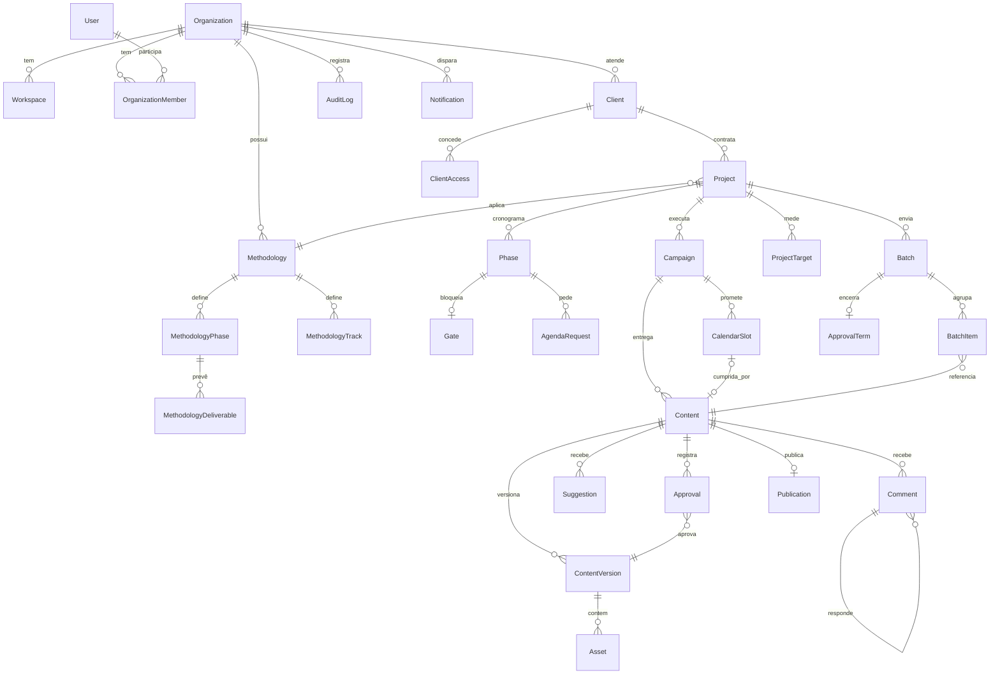

# DATA MODEL

Version: 1.0 · 2026-07-29 · Sprint 6 (antecipado)
PostgreSQL + Prisma. Escopo: MVP.

---

## Princípios

1. **Multi tenant é isolamento, não filtro.** Toda tabela de negócio carrega `organizationId`. Nenhuma query sem ele.
2. **Nada é sobrescrito.** Conteúdo tem versões imutáveis. (D-007)
3. **Aprovação aponta para uma versão exata.** Nunca para "o conteúdo". (D-032)
4. **Soft delete** onde há histórico a preservar; hard delete só em token e sessão.
5. **A promessa e a entrega são entidades separadas.** `CalendarSlot` ≠ `Content`. (D-022)
6. **Contrato e execução são níveis diferentes.** `Project` ≠ `Campaign`. (D-039)
7. **Todo evento importante é registrado.** Auditoria é append-only.

---

## ERD



---

## Convenções

Toda tabela de negócio:

```prisma
id             String    @id @default(uuid()) @db.Uuid
organizationId String    @db.Uuid
createdAt      DateTime  @default(now())
updatedAt      DateTime  @updatedAt
deletedAt      DateTime?
createdById    String?   @db.Uuid
updatedById    String?   @db.Uuid
```

- **UUID v4** em tudo. Nada de ID sequencial exposto.
- **`deletedAt`** implica filtro global no Prisma middleware. Nunca confiar no chamador.
- **Timestamps em UTC.** Timezone é do cliente, resolvido na borda.
- **Dinheiro** em centavos, `Int`. Nunca `Float`.
- **Enum no banco**, não string livre.

---

## Domínio 1 · Organização e acesso

```prisma
enum Role {
  SUPER_ADMIN
  AGENCY_ADMIN
  MANAGER
  ACCOUNT
  DESIGNER
  COPYWRITER
  VIDEOMAKER
  CLIENT
  CLIENT_VIEWER
}

model Organization {
  id        String  @id @default(uuid()) @db.Uuid
  name      String
  slug      String  @unique
  soundsOn  Boolean @default(true)   // D-023
  createdAt DateTime @default(now())
  updatedAt DateTime @updatedAt
  deletedAt DateTime?

  members       OrganizationMember[]
  clients       Client[]
  methodologies Methodology[]
  workspaces    Workspace[]
}

model Workspace {
  // existe no banco, sem UI no MVP
  id             String @id @default(uuid()) @db.Uuid
  organizationId String @db.Uuid
  name           String
  organization   Organization @relation(fields: [organizationId], references: [id])

  @@index([organizationId])
}

model User {
  id        String  @id @default(uuid()) @db.Uuid
  email     String  @unique
  name      String
  avatarUrl String?
  phone     String?              // WhatsApp — E.164
  locale    String  @default("pt-BR")
  theme     String  @default("system")
  soundsOn  Boolean @default(true)
  lastSeenAt DateTime?
  createdAt DateTime @default(now())
  deletedAt DateTime?

  memberships OrganizationMember[]
  sessions    Session[]

  // Cliente nunca tem senha — só link mágico (D-027).
  // passwordHash existe apenas para papéis de agência.
  passwordHash String?
}

model OrganizationMember {
  id             String @id @default(uuid()) @db.Uuid
  organizationId String @db.Uuid
  userId         String @db.Uuid
  role           Role
  invitedById    String? @db.Uuid
  acceptedAt     DateTime?
  createdAt      DateTime @default(now())
  deletedAt      DateTime?

  organization Organization @relation(fields: [organizationId], references: [id])
  user         User         @relation(fields: [userId], references: [id])

  @@unique([organizationId, userId])
  @@index([organizationId, role])
}

// Escopo do cliente: a quais clientes da agência esta pessoa tem acesso
model ClientAccess {
  id        String @id @default(uuid()) @db.Uuid
  organizationId String @db.Uuid
  memberId  String @db.Uuid
  clientId  String @db.Uuid
  createdAt DateTime @default(now())

  client Client @relation(fields: [clientId], references: [id])

  @@unique([memberId, clientId])
  @@index([clientId])
}

// Atribuição de equipe é POR PROJETO e cascateia para as campanhas (D-039)
model ProjectAssignment {
  id        String @id @default(uuid()) @db.Uuid
  organizationId String @db.Uuid
  memberId  String @db.Uuid
  projectId String @db.Uuid
  createdAt DateTime @default(now())

  project Project @relation(fields: [projectId], references: [id])

  @@unique([memberId, projectId])
  @@index([projectId])
}

model Session {
  id           String   @id @default(uuid()) @db.Uuid
  userId       String   @db.Uuid
  tokenHash    String   @unique
  deviceFp     String?
  ip           String?
  userAgent    String?
  expiresAt    DateTime
  lastUsedAt   DateTime @default(now())
  createdAt    DateTime @default(now())

  user User @relation(fields: [userId], references: [id], onDelete: Cascade)

  @@index([userId])
  @@index([expiresAt])
}

// Link mágico — uso único, hard delete ao consumir (D-027)
model MagicToken {
  id        String   @id @default(uuid()) @db.Uuid
  email     String
  tokenHash String   @unique
  purpose   String   // "invite" | "login"
  redirectTo String?
  expiresAt DateTime
  consumedAt DateTime?
  createdAt DateTime @default(now())

  @@index([email])
  @@index([expiresAt])
}
```

**Nota sobre `User.passwordHash`:** nullable de propósito. Cliente nunca cria senha. O campo existe só para papéis de agência, e o guard de login recusa senha para `CLIENT` e `CLIENT_VIEWER`.

---

## Domínio 2 · Metodologia (template)

```prisma
model Methodology {
  id             String  @id @default(uuid()) @db.Uuid
  organizationId String  @db.Uuid
  name           String
  objective      String
  question       String                     // a pergunta que o método responde
  signature      String?                    // assinatura de rodapé
  variables      Json    @default("[]")     // ["NOME DO EXPERT", "ÁREA", ...]
  prerequisites  Json    @default("[]")     // [{ label, description }]
  isSystem       Boolean @default(false)    // as 3 de fábrica
  version        Int     @default(1)
  createdAt      DateTime @default(now())
  updatedAt      DateTime @updatedAt
  deletedAt      DateTime?

  organization Organization        @relation(fields: [organizationId], references: [id])
  phases       MethodologyPhase[]
  tracks       MethodologyTrack[]
  projects     Project[]

  @@index([organizationId])
}

model MethodologyTrack {
  id            String @id @default(uuid()) @db.Uuid
  methodologyId String @db.Uuid
  name          String                      // "Conteúdo e Marca"
  description   String?
  color         String                      // token do design system
  order         Int

  methodology  Methodology @relation(fields: [methodologyId], references: [id], onDelete: Cascade)
  deliverables MethodologyDeliverable[]

  @@unique([methodologyId, order])
}

model MethodologyPhase {
  id            String  @id @default(uuid()) @db.Uuid
  methodologyId String  @db.Uuid
  order         Int
  name          String                      // "Fundação"
  label         String?                     // "Decisão", "Chegada"
  question      String                      // OBRIGATÓRIO — D-035
  note          String?                     // "Mês de obra — perfil sem publicação"
  durationDays  Int
  agendaDays    Int     @default(0)         // D-037
  agendaReason  String?
  scenarios     Json    @default("[]")      // MVP: texto. Fase 2: ramificação

  methodology  Methodology @relation(fields: [methodologyId], references: [id], onDelete: Cascade)
  deliverables MethodologyDeliverable[]
  gate         MethodologyGate?

  @@unique([methodologyId, order])
}

enum DeliverableKind {
  MILESTONE   // item de checklist
  VOLUME      // quantidade + formato → vira CalendarSlot (D-036)
}

model MethodologyDeliverable {
  id       String  @id @default(uuid()) @db.Uuid
  phaseId  String  @db.Uuid
  trackId  String  @db.Uuid
  kind     DeliverableKind
  label    String
  output   String?                          // "Saída: promessa em uma frase"
  quantity Int?                             // VOLUME
  format   ContentFormat?                   // VOLUME
  platform Platform?                        // VOLUME
  order    Int

  phase MethodologyPhase @relation(fields: [phaseId], references: [id], onDelete: Cascade)
  track MethodologyTrack @relation(fields: [trackId], references: [id], onDelete: Cascade)

  @@index([phaseId])
}

model MethodologyGate {
  id        String @id @default(uuid()) @db.Uuid
  phaseId   String @unique @db.Uuid
  question  String
  criteria  String
  decidedBy String  // "agency" | "agency+client"

  phase MethodologyPhase @relation(fields: [phaseId], references: [id], onDelete: Cascade)
}
```

**`MethodologyPhase.question` é `String` não-nulo.** A obrigatoriedade filosófica do produto vira restrição de banco. Não dá para criar fase sem pergunta nem por SQL direto.

---

## Domínio 3 · Cliente, projeto e cronograma

```prisma
enum ProjectStatus { DRAFT ACTIVE PAUSED FINISHED ARCHIVED }
enum PhaseStatus   { PENDING ACTIVE BLOCKED DONE }

model Client {
  id             String @id @default(uuid()) @db.Uuid
  organizationId String @db.Uuid
  name           String
  segment        String?
  brandNotes     String?
  logoUrl        String?
  createdAt      DateTime @default(now())
  updatedAt      DateTime @updatedAt
  deletedAt      DateTime?

  organization Organization   @relation(fields: [organizationId], references: [id])
  projects     Project[]
  accesses     ClientAccess[]

  @@index([organizationId])
}

model Project {
  id             String @id @default(uuid()) @db.Uuid
  organizationId String @db.Uuid
  clientId       String @db.Uuid
  methodologyId  String? @db.Uuid           // null = "Livre"
  name           String
  objective      String
  status         ProjectStatus @default(DRAFT)
  startsAt       DateTime
  endsAt         DateTime?
  variables      Json     @default("{}")    // { "NOME DO EXPERT": "Helena Braga" }

  // Estratégia vive no Projeto (D-039)
  audience       String?
  antiAudience   String?                    // o campo mais útil da tela
  pillars        Json     @default("[]")
  toneOfVoice    String?
  referenceIds   Json     @default("[]")    // ContentIds que servem de padrão (D-031)
  strategyStatus ContentStatus @default(DRAFT)
  strategyApprovedAt DateTime?

  createdAt DateTime @default(now())
  updatedAt DateTime @updatedAt
  deletedAt DateTime?

  client      Client       @relation(fields: [clientId], references: [id])
  methodology Methodology? @relation(fields: [methodologyId], references: [id])
  phases      Phase[]
  campaigns   Campaign[]
  targets     ProjectTarget[]
  batches     Batch[]
  assignments ProjectAssignment[]

  @@index([organizationId, status])
  @@index([clientId])
}

model Phase {
  id             String @id @default(uuid()) @db.Uuid
  organizationId String @db.Uuid
  projectId      String @db.Uuid
  order          Int
  name           String
  label          String?
  question       String                     // OBRIGATÓRIO
  note           String?
  startsAt       DateTime
  endsAt         DateTime
  agendaDays     Int    @default(0)
  agendaReason   String?
  agendaUsed     Int    @default(0)         // consumido × previsto (D-037)
  scenarios      Json   @default("[]")
  status         PhaseStatus @default(PENDING)

  project        Project @relation(fields: [projectId], references: [id], onDelete: Cascade)
  gate           Gate?
  agendaRequests AgendaRequest[]
  slots          CalendarSlot[]
  contents       Content[]
  batches        Batch[]

  @@unique([projectId, order])
  @@index([projectId, status])
}

model Gate {
  id         String @id @default(uuid()) @db.Uuid
  phaseId    String @unique @db.Uuid
  question   String
  criteria   String
  resolvedAt DateTime?
  resolvedById String? @db.Uuid
  outcome    String?                        // texto livre — Fase 2: ramifica
  rationale  String?

  phase Phase @relation(fields: [phaseId], references: [id], onDelete: Cascade)
}

model AgendaRequest {
  id        String @id @default(uuid()) @db.Uuid
  organizationId String @db.Uuid
  phaseId   String @db.Uuid
  days      Int
  reason    String
  proposedAt DateTime?
  confirmedAt DateTime?
  confirmedFor DateTime?
  usedDays  Int @default(0)

  phase Phase @relation(fields: [phaseId], references: [id], onDelete: Cascade)

  @@index([phaseId])
}

model ProjectTarget {
  id        String @id @default(uuid()) @db.Uuid
  projectId String @db.Uuid
  label     String                          // "conteúdos publicados"
  target    Int
  // realizado NUNCA é gravado — é calculado do publicado (Regra #3)

  project Project @relation(fields: [projectId], references: [id], onDelete: Cascade)

  @@index([projectId])
}
```

**`ProjectTarget` não tem coluna `achieved`.** O realizado é `COUNT` de `Publication` com sucesso. Guardar os dois é convite a estado inconsistente.

---

## Domínio 4 · Campanha, calendário e conteúdo

```prisma
enum Platform      { INSTAGRAM FACEBOOK LINKEDIN TIKTOK PINTEREST YOUTUBE X }
enum ContentFormat { POST CAROUSEL REELS STORY VIDEO ARTICLE }
enum ContentStatus {
  DRAFT
  IN_PRODUCTION
  AWAITING_APPROVAL
  CHANGES_REQUESTED
  APPROVED
  SCHEDULED
  PUBLISHED
  FAILED
}

model Campaign {
  id             String @id @default(uuid()) @db.Uuid
  organizationId String @db.Uuid
  projectId      String @db.Uuid            // OBRIGATÓRIO — campanha órfã não existe (D-039)
  trackId        String? @db.Uuid           // origem: trilha da metodologia
  name           String
  objective      String?
  color          String?
  order          Int    @default(0)
  createdAt DateTime @default(now())
  updatedAt DateTime @updatedAt
  deletedAt DateTime?

  project  Project        @relation(fields: [projectId], references: [id])
  slots    CalendarSlot[]
  contents Content[]

  @@index([projectId])
}

// A PROMESSA (D-022) — gerada pela metodologia (D-036)
model CalendarSlot {
  id             String @id @default(uuid()) @db.Uuid
  organizationId String @db.Uuid
  campaignId     String @db.Uuid
  phaseId        String? @db.Uuid
  contentId      String? @unique @db.Uuid   // 1:1 quando cumprida
  scheduledFor   DateTime
  platform       Platform
  format         ContentFormat
  note           String?
  createdAt DateTime @default(now())
  updatedAt DateTime @updatedAt
  deletedAt DateTime?

  campaign Campaign @relation(fields: [campaignId], references: [id])
  phase    Phase?   @relation(fields: [phaseId], references: [id])
  content  Content? @relation(fields: [contentId], references: [id])

  @@index([campaignId, scheduledFor])
  @@index([organizationId, scheduledFor])
}

// A ENTREGA
model Content {
  id             String @id @default(uuid()) @db.Uuid
  organizationId String @db.Uuid
  campaignId     String @db.Uuid
  phaseId        String? @db.Uuid           // derivado da data, fixável
  title          String
  format         ContentFormat
  platform       Platform
  status         ContentStatus @default(DRAFT)
  currentVersionId String? @unique @db.Uuid
  createdAt DateTime @default(now())
  updatedAt DateTime @updatedAt
  deletedAt DateTime?

  campaign    Campaign         @relation(fields: [campaignId], references: [id])
  phase       Phase?           @relation(fields: [phaseId], references: [id])
  versions    ContentVersion[] @relation("ContentVersions")
  current     ContentVersion?  @relation("CurrentVersion", fields: [currentVersionId], references: [id])
  comments    Comment[]
  suggestions Suggestion[]
  approvals   Approval[]
  batchItems  BatchItem[]
  slot        CalendarSlot?
  publication Publication?

  @@index([campaignId, status])
  @@index([organizationId, status])
}

// IMUTÁVEL. Nunca UPDATE. (D-007)
model ContentVersion {
  id        String @id @default(uuid()) @db.Uuid
  organizationId String @db.Uuid
  contentId String @db.Uuid
  number    Int
  copy      String
  cta       String?
  hashtags  String?
  seal      String                          // FNV-1a de copy+assets+meta (D-032)
  createdAt DateTime @default(now())
  createdById String? @db.Uuid

  content    Content  @relation("ContentVersions", fields: [contentId], references: [id], onDelete: Cascade)
  currentFor Content? @relation("CurrentVersion")
  assets     Asset[]
  approvals  Approval[]

  @@unique([contentId, number])
  @@index([contentId])
}

model Asset {
  id        String @id @default(uuid()) @db.Uuid
  organizationId String @db.Uuid
  versionId String @db.Uuid
  kind      String                          // "image" | "video"
  url       String
  mimeType  String
  bytes     Int
  width     Int?
  height    Int?
  durationMs Int?
  order     Int    @default(0)              // slide do carrossel
  metadata  Json   @default("{}")

  version ContentVersion @relation(fields: [versionId], references: [id], onDelete: Cascade)

  @@index([versionId])
}
```

---

## Domínio 5 · Comentários e sugestões

```prisma
model Comment {
  id        String @id @default(uuid()) @db.Uuid
  organizationId String @db.Uuid
  contentId String @db.Uuid
  versionId String? @db.Uuid
  parentId  String? @db.Uuid                // thread
  authorId  String @db.Uuid
  body      String
  isInternal Boolean @default(false)        // NUNCA visível ao cliente
  assetId   String? @db.Uuid                // pin: em qual slide
  pinX      Float?                          // 0–100 (%)
  pinY      Float?
  pinNumber Int?
  resolvedAt DateTime?
  resolvedById String? @db.Uuid
  createdAt DateTime @default(now())
  updatedAt DateTime @updatedAt
  deletedAt DateTime?

  content Content   @relation(fields: [contentId], references: [id], onDelete: Cascade)
  parent  Comment?  @relation("Thread", fields: [parentId], references: [id])
  replies Comment[] @relation("Thread")

  @@index([contentId, isInternal])
}

enum SuggestionStatus { PENDING ACCEPTED REJECTED SUPERSEDED }

// A edição de copy do cliente. PROPOSTA, nunca escrita direta. (D-025, PERMISSIONS)
model Suggestion {
  id        String @id @default(uuid()) @db.Uuid
  organizationId String @db.Uuid
  contentId String @db.Uuid
  versionId String @db.Uuid                 // sobre qual versão foi feita
  authorId  String @db.Uuid
  before    String
  after     String
  status    SuggestionStatus @default(PENDING)
  resolvedAt DateTime?
  resolvedById String? @db.Uuid
  createdAt DateTime @default(now())

  content Content @relation(fields: [contentId], references: [id], onDelete: Cascade)

  @@index([contentId, status])
}
```

**`Comment.isInternal`** é a única barreira dura entre os dois shells. Todo repositório que serve conteúdo para papel `CLIENT*` aplica `isInternal = false` no nível do repositório, não do controller.

---

## Domínio 6 · Lote, aprovação e termo

```prisma
enum BatchStatus { DRAFT SENT PARTIAL CLOSED }
enum Decision    { APPROVED CHANGES_REQUESTED }

// O lote pertence ao PROJETO, não à campanha (D-040)
model Batch {
  id             String @id @default(uuid()) @db.Uuid
  organizationId String @db.Uuid
  projectId      String @db.Uuid
  phaseId        String? @db.Uuid
  name           String                     // "Lote 01 · Agosto"
  goal           String                     // objetivo do mês — obrigatório no envio
  message        String?
  referenceIds   Json   @default("[]")      // D-031
  status         BatchStatus @default(DRAFT)
  seal           String?                    // selo no envio (D-032)
  sentAt         DateTime?
  sentById       String? @db.Uuid
  createdAt DateTime @default(now())
  updatedAt DateTime @updatedAt
  deletedAt DateTime?

  project Project      @relation(fields: [projectId], references: [id])
  phase   Phase?       @relation(fields: [phaseId], references: [id])
  items   BatchItem[]
  term    ApprovalTerm?

  @@index([projectId, status])
}

model BatchItem {
  id        String @id @default(uuid()) @db.Uuid
  batchId   String @db.Uuid
  contentId String @db.Uuid
  versionId String @db.Uuid                 // a versão exata enviada
  order     Int
  seenAt    DateTime?                       // exige ter aberto uma vez

  batch   Batch   @relation(fields: [batchId], references: [id], onDelete: Cascade)
  content Content @relation(fields: [contentId], references: [id])

  @@unique([batchId, contentId])
}

// Registro imutável. Nunca UPDATE.
model Approval {
  id             String @id @default(uuid()) @db.Uuid
  organizationId String @db.Uuid
  contentId      String @db.Uuid
  versionId      String @db.Uuid            // aponta para versão exata (D-032)
  batchId        String? @db.Uuid
  decision       Decision
  decidedById    String @db.Uuid
  seal           String                     // selo aprovado
  ip             String?
  userAgent      String?
  device         String?
  isOffline      Boolean @default(false)    // D-029
  offlineById    String? @db.Uuid           // quem da agência registrou
  undoneAt       DateTime?                  // desfazer — nunca deleta
  notifyAfter    DateTime                   // janela de 60s (D-025)
  notifiedAt     DateTime?
  createdAt      DateTime @default(now())

  content Content        @relation(fields: [contentId], references: [id])
  version ContentVersion @relation(fields: [versionId], references: [id])

  @@index([contentId])
  @@index([notifyAfter, notifiedAt])
}

// D-033 — promovido da Fase 2
model ApprovalTerm {
  id             String @id @default(uuid()) @db.Uuid
  organizationId String @db.Uuid
  batchId        String @unique @db.Uuid
  signedById     String @db.Uuid
  signedName     String                     // nome digitado, não o do perfil
  itemCount      Int
  approvedCount  Int
  changesCount   Int
  seal           String
  reference      String @unique             // "apr_9k2mQx"
  ip             String?
  userAgent      String?
  device         String?
  signedAt       DateTime @default(now())

  batch Batch @relation(fields: [batchId], references: [id])
}
```

---

## Domínio 7 · Publicação, notificação e auditoria

```prisma
enum PublicationStatus { QUEUED PUBLISHING PUBLISHED FAILED CANCELLED }

model Publication {
  id             String @id @default(uuid()) @db.Uuid
  organizationId String @db.Uuid
  contentId      String @unique @db.Uuid
  versionId      String @db.Uuid            // a versão que FOI ao ar
  platform       Platform
  scheduledFor   DateTime
  status         PublicationStatus @default(QUEUED)
  externalId     String?
  externalUrl    String?
  error          String?
  attempts       Int @default(0)
  publishedAt    DateTime?

  content Content @relation(fields: [contentId], references: [id])

  @@index([organizationId, status, scheduledFor])
}

enum Channel { IN_APP EMAIL WHATSAPP PUSH }

model Notification {
  id             String @id @default(uuid()) @db.Uuid
  organizationId String @db.Uuid
  recipientId    String @db.Uuid
  channel        Channel
  event          String                     // "BatchSent", "ContentApproved"
  payload        Json
  scheduledFor   DateTime @default(now())   // janela de resfriamento
  sentAt         DateTime?
  readAt         DateTime?
  cancelledAt    DateTime?                  // desfazer dentro da janela
  error          String?
  createdAt      DateTime @default(now())

  @@index([recipientId, readAt])
  @@index([scheduledFor, sentAt])
}

// Append-only. Nunca UPDATE, nunca DELETE. (Regra #6)
model AuditLog {
  id             String @id @default(uuid()) @db.Uuid
  organizationId String @db.Uuid
  actorId        String? @db.Uuid
  action         String                     // "content.approve"
  entityType     String
  entityId       String @db.Uuid
  before         Json?
  after          Json?
  reason         String?
  ip             String?
  userAgent      String?
  device         String?
  createdAt      DateTime @default(now())

  @@index([organizationId, createdAt])
  @@index([entityType, entityId])
}

// Fila de eventos de domínio (D-006)
model DomainEvent {
  id             String @id @default(uuid()) @db.Uuid
  organizationId String @db.Uuid
  name           String
  payload        Json
  processedAt    DateTime?
  attempts       Int @default(0)
  error          String?
  createdAt      DateTime @default(now())

  @@index([processedAt, createdAt])
}
```

---

## Invariantes

As regras que o banco e a camada de aplicação garantem juntos. **Cada uma é um teste.**

| # | Invariante | Onde é garantido | Decisão |
|---|---|---|---|
| I-01 | Nenhuma query de negócio sem `organizationId` | Prisma middleware + teste de contrato | ARCH |
| I-02 | `ContentVersion` nunca sofre UPDATE | trigger `BEFORE UPDATE` → erro | D-007 |
| I-03 | `AuditLog` nunca sofre UPDATE nem DELETE | grant do Postgres: só INSERT/SELECT | Regra #6 |
| I-04 | `Approval` nunca sofre UPDATE, exceto `undoneAt` e `notifiedAt` | trigger de coluna | D-007 |
| I-05 | `status = APPROVED` exige `approval.versionId = content.currentVersionId` | trigger + job de reconciliação | **D-032** |
| I-06 | Alterar conteúdo aprovado cria versão nova e rebaixa o status | serviço + I-05 | **D-032** |
| I-07 | `Publication` só é criada com conteúdo `APPROVED` | check no serviço + constraint | **D-022** |
| I-08 | `Campaign.projectId` é NOT NULL | schema | **D-039** |
| I-09 | `Phase.question` e `MethodologyPhase.question` são NOT NULL | schema | D-035 |
| I-10 | `Batch.goal` é obrigatório no envio (`status != DRAFT`) | check constraint | wireflow 4 |
| I-11 | `ApprovalTerm` só existe com todos os `BatchItem` decididos | serviço | D-033 |
| I-12 | Papel `CLIENT*` nunca lê `Comment.isInternal = true` | repositório, não controller | PERM |
| I-13 | Papel de agência nunca cria `Approval` sem `isOffline = true` | guard + check | **D-029** |
| I-14 | `Suggestion` nunca escreve em `ContentVersion.copy` | ausência de caminho no serviço | Regra #3 |
| I-15 | `Notification` de aprovação só envia após `notifyAfter` | worker | **D-025** |
| I-16 | Desfazer antes de `notifyAfter` marca `cancelledAt` e não envia nada | worker | **D-025** |
| I-17 | `ProjectTarget` não tem valor realizado gravado | schema | Regra #3 |
| I-18 | Gate não resolvido bloqueia `Phase` seguinte (`BLOCKED`) | serviço | D-035 |
| I-19 | Estratégia não aprovada bloqueia edição de `CalendarSlot` | guard | wireflow 2 |
| I-20 | `MagicToken` é consumido uma vez e deletado | serviço | D-027 |
| I-21 | `User.passwordHash` é null para `CLIENT` e `CLIENT_VIEWER` | guard de login | D-027 |

**I-05 é a invariante central do produto.** É ela que transforma *"o que foi aprovado é o que vai ao ar"* de promessa em propriedade do sistema.

---

## Índices críticos

```sql
-- fila de aprovações ordenada por risco
CREATE INDEX idx_content_awaiting
  ON "Content" ("organizationId", status, "updatedAt")
  WHERE status = 'AWAITING_APPROVAL' AND "deletedAt" IS NULL;

-- alerta de publicação sem peça aprovada (48h)
CREATE INDEX idx_slot_uncovered
  ON "CalendarSlot" ("organizationId", "scheduledFor")
  WHERE "contentId" IS NULL AND "deletedAt" IS NULL;

-- worker de notificação com janela de resfriamento
CREATE INDEX idx_notification_due
  ON "Notification" ("scheduledFor")
  WHERE "sentAt" IS NULL AND "cancelledAt" IS NULL;

-- publicação agendada
CREATE INDEX idx_publication_due
  ON "Publication" ("scheduledFor")
  WHERE status = 'QUEUED';
```

Índices parciais em vez de completos: as tabelas quentes são pequenas em relação ao total, e o `WHERE` mantém o índice em memória.

---

## Seeds obrigatórios

Toda organização nova recebe:

1. As **3 metodologias de fábrica** — `Social sempre ativo`, `Lançamento 90 dias`, `Livre` (`isSystem = true`)
2. Nada mais. Cliente, projeto e campanha nascem do onboarding.

Todo cliente novo recebe:

1. Um `Project` "Sempre ativo" com a metodologia homônima
2. Uma `Campaign` a partir da trilha única dessa metodologia

Ninguém começa em tela vazia. (`HIERARQUIA.md`)

---

## Fora do MVP

Modelado agora, sem UI: `Workspace`.
Não modelado: aprovação múltipla com quórum · ramificação de cenários · permissão granular por campanha · biblioteca pública de metodologias · analytics de resultado · assinatura ICP-Brasil.

Todos cabem no schema atual sem migração destrutiva. Foi por isso que `Gate.outcome` é texto livre e `scenarios` é `Json`.
